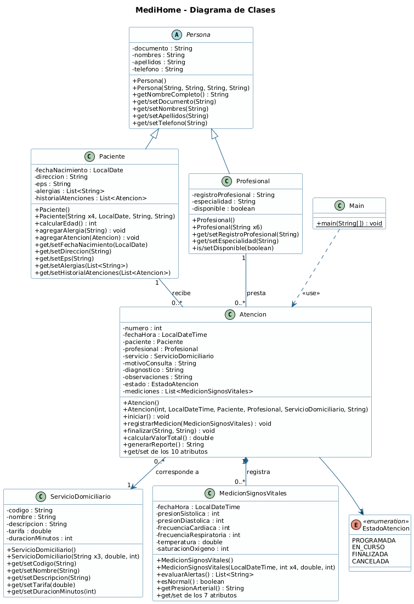

# MediHome – Sistema de Atención Médica Domiciliaria

Proyecto de clase: modelado UML (Visual Paradigm) e implementación en Java del caso **MediHome**.

## Integrantes

| Nombre | Código / Documento | Usuario GitHub |
|--------|--------------------|----------------|
| NOMBRE COMPLETO INTEGRANTE 1 | 0000000000 | @usuario1 |
| NOMBRE COMPLETO INTEGRANTE 2 | 0000000000 | @usuario2 |

## Diagrama de clases

El diagrama UML está incluido en el repositorio como imagen y como fuente PlantUML editable:



- Imagen del diagrama: [diagrama/referencia_plantuml.png](diagrama/referencia_plantuml.png)
- Fuente PlantUML: [diagrama/medihome.puml](diagrama/medihome.puml)
- Diagrama resumido: [diagrama/MediHome_Resumido.png](diagrama/MediHome_Resumido.png)
- Fuente PlantUML resumida: [diagrama/medihome_resumido.puml](diagrama/medihome_resumido.puml)

## Clases del modelo

| Clase | Responsabilidad |
|-------|-----------------|
| `Persona` | Clase abstracta con los datos comunes (documento, nombres, apellidos, teléfono). |
| `Paciente` | Persona que recibe la atención; guarda dirección, EPS, alergias e historial. |
| `Profesional` | Persona del área de la salud que presta el servicio. |
| `ServicioDomiciliario` | Servicio ofrecido (código, nombre, tarifa, duración). |
| `Atencion` | Visita domiciliaria que une paciente, profesional y servicio; genera el reporte. |
| `MedicionSignosVitales` | Signos vitales tomados en la atención; detecta valores fuera de rango. |
| `EstadoAtencion` | Enumeración: PROGRAMADA, EN_CURSO, FINALIZADA, CANCELADA. |
| `Main` | Instancia los objetos y muestra el reporte de la atención. |

## Relaciones

- `Paciente` y `Profesional` **heredan** de `Persona`.
- Un `Paciente` recibe 0..* atenciones; un `Profesional` presta 0..* atenciones.
- Cada `Atencion` corresponde a 1 `ServicioDomiciliario`.
- Una `Atencion` **se compone** de 0..* `MedicionSignosVitales`.

## Cómo ejecutar

Requiere JDK 17 o superior.

```bash
javac -encoding UTF-8 -d out src/medihome/*.java
java -cp out medihome.Main
```

También se puede abrir la carpeta en NetBeans, IntelliJ o VS Code y ejecutar `Main.java`.
